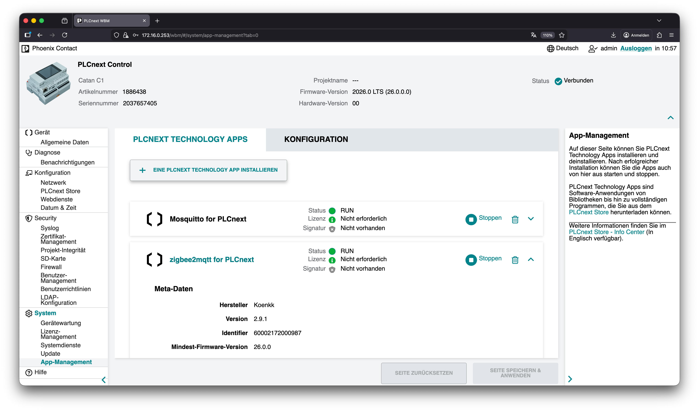

# evcc for Catan C1 (PLCnext)

[evcc](https://github.com/evcc-io/evcc) app image for **Phoenix Contact Catan C1**

> [!WARNING]
> This is an unofficial community project. It is not affiliated with, endorsed by, or supported by Phoenix Contact.
> No support is provided. Use at your own risk; the software comes without any warranty (see [LICENSE](LICENSE)).

- Firm Code `0000000`
- Product Codes `1337002`

## Supported Devices

- Controller - Catan C1 - 1886438 (Phoenix Contact)

## Usage

- Web UI: `http://<ip of the Catan C1>:57070/`
- Configure evcc in the web UI. All settings are stored in the database `evcc.db` in the app's persistent storage, which is kept on app updates. An `evcc.yaml` is not used.
- Persistent data on the controller: `/opt/plcnext/apps/home/data/00000001337002/data/` (`evcc.db`, `evcc.db-shm`, `evcc.db-wal`). For a backup, stop the app first; while evcc is running, `evcc.db` alone may not contain the latest changes.
- OCPP chargers connect to `ws://<ip of the Catan C1>:58887/<station id>`. The evcc UI shows port `8887` instead, which is the port inside the container.

## Serial interfaces

For Modbus RTU meters and chargers, use these device paths in evcc:

| Interface | Device |
| --- | --- |
| RS-485 (1) | `/dev/ttymxc3` |
| RS-485 (2) | `/dev/ttymxc2` |
| USB serial devices | `/dev/usb-devices/symlinks/...` |

> [!NOTE]
> USB devices are supported since firmware `2026.0.3`.

USB path (example):

```
/dev/usb-devices/symlinks/usb-<vendor>_<product>_<serial>-if00-port0
```

## WBM



## Known issues

- No support for ch340/ch341 chipsets (used by many low-cost USB RS-485 adapters)
- The container does not use host networking. Devices that need multicast or discovery, such as the SMA Energy Meter / Sunny Home Manager and EEBus, do not work.

## License

The packaging in this repository is licensed under MIT, see [LICENSE](LICENSE). evcc itself is licensed under MIT, see [LICENSE-evcc](LICENSE-evcc).

## Dev

### Build

```bash
sudo apt install -y squashfs-tools docker-ce docker-ce-cli
bash build.sh <app version>   # e.g. bash build.sh 1.2.0
```

### Release

Publishing a GitHub release (tag e.g. `v1.2.0`) builds the app with that version and attaches a `.zip` with the `.app`, `.md5`, `LICENSE` and `LICENSE-evcc` files to the release.
